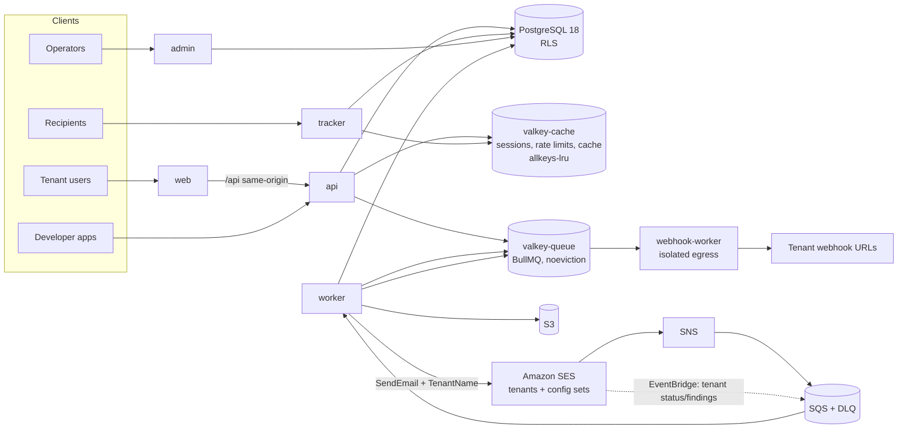
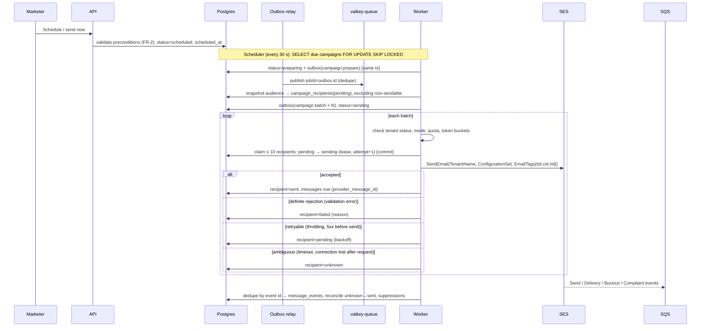

# 02 — System Architecture

**Status:** v1.0 — **approved** (Phase 1 approval: D1–D4, 2026-10-14). Changes from now on go through change control: update the doc, the ADR if relevant, and PROGRESS.md.
**Last updated:** 2026-10-14
**Related:** ADRs in `docs/adr/`, policies in `06-deliverability-policy.md`, operations in `07-operations-readiness.md`

## 1. Architectural style

A **modular monolith** in TypeScript: one codebase deployed as separate processes (ADR-001).

| Process | Responsibility | Credentials it holds |
|---|---|---|
| `web` | Next.js dashboard. The browser reaches `api` through a **same-origin `/api` rewrite**. | none for the DB |
| `api` | Tenant-facing REST API (dashboard and public API) | DB role `app_user` |
| `tracker` | Open pixel, click redirect, unsubscribe page and one-click endpoint | `app_user` (writes only through the event queue and the unsubscribe service) |
| `worker` | BullMQ processors: sending, imports, event ingestion, scheduler, reconciler, outbox relay | `app_user` |
| `webhook-worker` | Outbound tenant webhooks only, on an **isolated network egress** path (§9) | `app_user` (read-only use) |
| `admin` | Operator console and API, served on a separate hostname and deployment | `app_user` plus `app_admin_fn` (§4.4). **Never deployed with the tenant-facing services.** |

## 2. High-level diagram

## 3. Module boundaries

| Module | Responsibility | Owns tables |
|---|---|---|
| `identity` | users, MFA, verification and reset tokens (sessions live in valkey-cache) | users, mfa_factors, user_tokens |
| `tenancy` | tenants, memberships, invites, roles, API keys, audit | tenants, memberships, invitations, api_keys, audit_logs |
| `domains` | sending domains, DNS checks, SES identity and tenant association | sending_domains |
| `audience` | contacts, fields, lists, tags, segments, consent, imports and exports | contacts, contact_*, lists, tags, segments, imports, exports |
| `content` | templates, MJML compile, LiquidJS render | templates |
| `campaigns` | lifecycle, scheduling, audience snapshot | campaigns, campaign_recipients |
| `sending` | `ChannelProvider`, sending-mode guard, throttling, quotas, dispatch | messages, tenant_sending_policies |
| `tracking` | opens, clicks, provider events, reconciliation | message_events, links, processed_provider_events |
| `suppression` | tenant and platform suppression, `isSendable` | tenant_suppressions, platform_suppressions |
| `jobs` | outbox, scheduler, reconciler | outbox |
| `webhooks` | endpoints, deliveries, SSRF guard | webhook_endpoints, webhook_deliveries |
| `billing` | plans, subscriptions, usage, invoice data | plans, subscriptions, usage_counters |
| `platform` | operators, tenant review, health | operators, operator_* |

Modules call each other only through their public service interfaces. **dependency-cruiser** enforces this in CI.

## 4. Tenant isolation (ADR-002)

### 4.1 Layers

1. Every tenant table has `tenant_id NOT NULL`, and indexes lead with `tenant_id`.
2. `ENABLE` and `FORCE ROW LEVEL SECURITY` on every tenant table, with the policy `tenant_id = (SELECT current_setting('app.tenant_id', true))::uuid`. The `SELECT` wrapper makes Postgres evaluate the setting once per query instead of once per row.
3. Database roles:

| Role | Login | Attributes | Used by |
|---|---|---|---|
| `app_migrator` | yes | owns the schema | CI/CD migrations only |
| `app_user` | yes | **no** `BYPASSRLS`, not a table owner | api, tracker, worker, webhook-worker, admin |
| `rls_lookup` | **no** | `BYPASSRLS`; owns the pre-tenant lookup functions | never logs in |
| `app_admin_fn` | **no** | `BYPASSRLS`; owns the operator functions | never logs in |
| `admin_user` | yes | **no** `BYPASSRLS`; may execute operator functions | `admin` only |

No login role has `BYPASSRLS`. Privileged reads happen only inside audited, narrowly scoped `SECURITY DEFINER` functions.

4. `withTenant(tenantId, fn)` runs a transaction and calls `set_config('app.tenant_id', $1, true)`. The setting is transaction-local, so it is safe with poolers in transaction mode. With no tenant set, every query sees **zero rows** (fail closed).
5. The tenant comes from the session (with membership checked) or from the API key. It is **never** read from a request body. Job payloads carry `tenantId`, and handlers always use `withTenant`.
6. Redis keys are prefixed `t:{tenantId}:` and S3 keys `tenants/{tenantId}/`.

### 4.2 Pre-tenant lookups

Some legitimate operations happen before the tenant is known. Each one uses a narrow function (full signatures in `04-database-design.md` §4):

| Situation | Mechanism |
|---|---|
| API-key authentication | `auth_api_key(prefix, secret_hash)` returns `(tenant_id, key_id, scopes)` only when the key matches and is active. The hash itself is never returned. |
| Invitation acceptance | `lookup_invitation(token_hash)` returns the invitation summary only if it is pending and unexpired |
| List my organisations | `list_user_memberships(user_id)` |
| SES events | `resolve_provider_message(provider, provider_message_id)` returns `tenant_id` plus message keys. SES events also carry our `EmailTags` (`tid`, `rid`), which are cross-checked against it. |
| Tracker and unsubscribe | **No lookup.** The HMAC-signed token contains `tenant_id`. |
| Platform suppression check | `platform_suppressed(channel, contact_ids[])` answers only for the current tenant's own contacts and returns booleans only (§7.3) |

Rules for every lookup function:
- owned by `rls_lookup`;
- `SECURITY DEFINER` with `SET search_path = pg_catalog, pg_temp`, and every object referenced by its schema-qualified name;
- `REVOKE ALL ... FROM PUBLIC` and `GRANT EXECUTE` only to `app_user`;
- returns the minimum set of columns;
- each has its own tests;
- a CI **catalog test** fails the build if any `SECURITY DEFINER` function lacks a pinned `search_path` or is executable by `PUBLIC`.

### 4.3 Isolation test suite

This suite blocks CI. It:
- creates two tenants;
- for every tenant table, asserts that cross-tenant `SELECT`, `INSERT`, `UPDATE` and `DELETE` are blocked, that a spoofed `tenant_id` on insert is rejected by `WITH CHECK`, and that an unset tenant sees zero rows;
- runs a catalog test that fails if any table with a `tenant_id` column lacks forced RLS;
- runs endpoint-level tests that call every tenant-scoped route with tenant B's credentials and tenant A's resource IDs.

### 4.4 Operators

- Operators live in an `operators` table that is **separate from tenant users**. MFA is mandatory, sessions are short (8 h absolute, 30 min idle), and an IP allowlist is optional.
- The admin app runs on its own hostname and deployment, so tenant-facing services never hold admin credentials.
- Operator actions use `app_admin_fn` functions, for example `admin_tenant_health()` and `admin_set_tenant_status()`. Each function writes an audit row.
- Ad-hoc SQL access to production goes through break-glass access only, with logging.

## 5. Authentication and authorization

**Authentication**
- **Passwords:** Argon2id via `@node-rs/argon2`, with parameters tuned to about 250 ms.
- **Sessions:** stored server-side in valkey-cache. Cookie `__Host-dm_session`: HttpOnly, Secure, SameSite=Lax. Idle timeout 12 h, absolute lifetime 14 days. The session ID rotates on login and privilege change.
- **CSRF:** SameSite plus an Origin/Referer check on every state-changing request. The API rejects missing or mismatched origins.
- **Tokens** (verification, reset, invitation): 32 random bytes, stored as a SHA-256 hash, single use, with expiries of 24 h, 1 h and 7 d respectively.
- **MFA:** TOTP (otplib) with 10 single-use recovery codes. The secret is envelope-encrypted with KMS in AWS and with a local key in development.
- **Signup:** no account enumeration. Signup and reset always return the same response.

**Authorization: permission matrix (MVP).** ✅ = allowed

| Permission | Owner | Admin | Marketer | Developer | Viewer |
|---|---|---|---|---|---|
| Billing, delete org, transfer ownership | ✅ | | | | |
| Manage members and roles (up to own role) | ✅ | ✅ | | | |
| Sending domains | ✅ | ✅ | | | |
| API keys and webhooks | ✅ | ✅ | | ✅ | |
| Contacts, lists, tags, import, segments | ✅ | ✅ | ✅ | | |
| Export contacts / erase contact | ✅ | ✅ | | | |
| Templates, campaigns (create/edit) | ✅ | ✅ | ✅ | | |
| Send or schedule campaigns | ✅ | ✅ | ✅ | | |
| Suppression management | ✅ | ✅ | ✅ (add only) | | |
| View reports, contacts, campaigns | ✅ | ✅ | ✅ | ✅ | ✅ |
| Audit log | ✅ | ✅ | | | |

Enforcement happens in the service layer. Every route declares its permission, and a test fails if any route lacks one (default deny). API keys carry scopes (`messages:send`, `contacts:read`, `contacts:write`, `lists:write`, `webhooks:manage`) instead of roles.

## 6. Sending pipeline and delivery guarantees (ADR-007)

### 6.1 Flow

### 6.2 Recipient state machine (`campaign_recipients.status`)

`pending → sending → sent | failed | unknown`, plus `skipped` (not sendable when the snapshot or batch was taken).

- The `sending` state is committed **before** the provider is called. A worker that crashes leaves its in-flight recipients (at most 10 per worker) in `sending` with an expired lease. The reconciler moves them to **`unknown`, never back to `pending`**.
- `unknown` recipients are reconciled by the SES `Send` event, matched through the `rid` tag. Those still unresolved after 24 h become `unknown_final`, which reports show separately. A tenant may **explicitly** choose "retry unconfirmed recipients" and accept the duplicate risk. Nothing resends automatically.
- `(tenant_id, campaign_id, contact_id)` is the primary key of `campaign_recipients`, which is not partitioned. That makes a second row for the same contact impossible.

### 6.3 Delivery guarantees

| Flow | Guarantee | Mechanism |
|---|---|---|
| Campaign email → provider | **At most once per (campaign, contact)**; ambiguous outcomes are surfaced, not retried | Recipient state machine (§6.2) |
| Transactional API → provider | At most once per `Idempotency-Key` (24 h). Without a key, there is no deduplication. | `idempotency_keys` table |
| Background jobs | At least once; handlers are idempotent | BullMQ plus DB state checks |
| Outbox → queue | At least once; deduplicated by `jobId` | Outbox relay |
| Provider events → DB | Effectively once | `processed_provider_events` primary key on the event ID |
| Tracker events | At least once; "unique" metrics deduplicated in queries | `message_events` |
| Outbound webhooks | At least once; each event has a stable `webhook-id` the receiver can deduplicate on | Standard Webhooks headers |
| Unsubscribe | Idempotent; effective at most 1 minute after the POST | Synchronous DB write |

**We do not claim exactly-once delivery** to any external system.

### 6.4 Queue and cache separation and durability (ADR-004)

- **valkey-queue** holds BullMQ only. `maxmemory-policy noeviction`, Multi-AZ replica with automatic failover, alarm at 70% memory.
- **valkey-cache** holds sessions, rate limits and caches. `allkeys-lru`. Losing it logs users out, and nothing else.
- **Postgres is the source of truth.** Campaign schedules (`scheduled_at`), batch progress (`campaign_recipients`) and pending work (`outbox`) live in the database. Losing queue contents costs time, not correctness:
  - **Scheduler** (every 30 s) enqueues due campaigns.
  - **Outbox relay** (continuous, every 1 s) publishes unpublished outbox rows.
  - **Reconciler** (every 60 s) finds campaigns in `preparing` or `sending` with no progress for more than 5 min and re-enqueues their batches. Duplicate batch jobs are harmless because claims are atomic.
  - **Lease sweeper** (every 60 s) moves `sending` recipients with expired leases to `unknown`.
- Managed ElastiCache does not offer AOF persistence on current engines (to verify in the Sprint 2 spike). Durability therefore comes from the reconciliation design above. **MemoryDB** is the upgrade path if queue durability ever needs to be stronger.
- Throttling uses **custom token buckets as Redis Lua scripts** on valkey-queue at three levels: platform (≤ 80% of the SES max send rate), tenant (quota), and recipient domain. Open-source BullMQ has no grouped rate limits.

## 7. Email provider: Amazon SES (ADR-003)

### 7.1 Mapping

| Our concept | SES resource |
|---|---|
| Tenant | **SES tenant**, 1:1, named `t-{tenantId}` and created when the tenant is approved |
| Tenant sending domain | SES domain identity (Easy DKIM 2048, custom MAIL FROM), **associated with that SES tenant** |
| Marketing / transactional streams | Shared configuration sets `cs-mkt-new`, `cs-mkt-std` and `cs-txn`, associated with each SES tenant. Event destinations: SNS → SQS. |
| Platform system mail (verification, reset, invites) | Our own domain and the `cs-system` configuration set. **No SES tenant.** |
| Tenant reputation policy | **Strict** for `sandbox` and `new` tiers, **Standard** for `standard` and `trusted` |

### 7.2 SES suppression configuration: reassessed

**Options compared:**

| Option | Behaviour | Pros | Cons |
|---|---|---|---|
| A. Account-level list (default) | Any tenant's bounce **or complaint** suppresses the address for all tenants | Zero work; strongest protection of shared reputation | **Leaks tenant-specific complaints across tenants**; unexplained suppressions; conflicts with C3 |
| B. Disable SES suppression; rely only on our DB | SES attempts every send we make | Full control | If our checks have a bug, there is **no backstop**: repeat hard bounces hurt reputation. Rejected as unsafe. |
| **C. SES tenant-level suppression** (`SuppressionScope=TENANT`, reasons `BOUNCE`+`COMPLAINT`) | Bounces and complaints suppress only within that tenant. Hard bounces also go to the SES global list (AWS behaviour). | Matches our privacy model; keeps an AWS-side backstop; supports per-tenant reputation enforcement | Newer feature; small cost ($0.005/tenant/month + $0.005 per 1k emails); suppressed sends still count toward quota |

**Decision: Option C**, plus our own database as the **primary** check (SES only ever sees mail we already consider sendable). The platform `cs-system` stream uses account-level suppression (BOUNCE+COMPLAINT), which is safe because only our own mail goes through it.

- **Fallback** if the Sprint 2 spike shows C is unavailable or unreliable in ap-south-1: per-tenant configuration sets with suppression override **enabled for `BOUNCE` only** at account scope (hard bounces are a fact about the address, so sharing them leaks nothing tenant-specific). Complaints are handled only in our database.
- **Synchronisation:** SES-side suppressions show up as bounce events with subtype `OnTenantSuppressionList` / `OnAccountSuppressionList`. Ingestion mirrors these into our tables, so our database stays complete and explainable.
- **Gmail caveat:** Gmail does not send complaint data to SES, so complaint metrics exclude Gmail. We compensate with Gmail Postmaster Tools and engagement-based sunsetting (`06-deliverability-policy.md`).

### 7.3 Our suppression model (ADR-012)

- **`tenant_suppressions`** (RLS): unsubscribes, complaints, soft bounces repeated past a threshold, and manual entries. **Private to the tenant.**
- **`platform_suppressions`** (no `app_user` grants at all) is **strictly qualified**. Only these can create an entry:
  - permanent mailbox bounces with matching `5.1.x` evidence;
  - invalid domains confirmed twice at least 24 h apart;
  - invalid syntax;
  - operator-confirmed spam traps or abuse.

  **Temporary failures, policy blocks (`5.7.x`), complaints and unsubscribes never create a shared entry.**
- Entries are stored as an **HMAC of the address**, never plaintext.
- Tenants call `platform_suppressed()` only for **their own contacts**, and get booleans back. The UI shows "Undeliverable (platform)" with no source tenant and no date.
- False positives are corrected through a tenant re-check request, audited operator removal, automatic re-validation of domain-level entries, and bulk reversal by classifier version.
- The full policy is in `06-deliverability-policy.md` §7.

## 8. Unsubscribe handling (ADR-010)

| Request | Behaviour |
|---|---|
| `GET /u/{token}` (footer link, scanners, previews) | **Read-only.** Shows "Unsubscribe x***@domain.com from <Tenant> marketing emails?" with a button that submits a POST. Never mutates state. |
| `POST /u/{token}` with body `List-Unsubscribe=One-Click` (mailbox provider, RFC 8058) | Unsubscribes immediately and returns `200`. No cookie, session or CSRF token is required, because the signed token is the authorization. Idempotent. |
| `POST /u/{token}/confirm` (button on the page) | Unsubscribes, then shows a confirmation page with a "resubscribe" option. Resubscribing requires another explicit click and is recorded as consent. |
| `HEAD` or any other method | No state change |

- **Token:** `v1.{kid}.{base64url(payload)}.{hmac}`. The payload is `{t: tenantId, c: contactId, m: messageId, ch: "email", s: "marketing"}`, signed with HMAC-SHA256.
  - It contains no email address and **never expires**.
  - Signing keys rotate yearly, and old keys stay valid for verification for at least 24 months.
  - Tampered tokens, unknown key IDs or deleted contacts all get the same generic response, so the endpoint can't be used as an oracle.
- **Headers:** `List-Unsubscribe: <https://u.{platform-domain}/u/{token}>` and `List-Unsubscribe-Post: List-Unsubscribe=One-Click`. In the MVP there is **no `mailto:`**, because SES inbound receiving in ap-south-1 is unconfirmed and RFC 8058 only needs the https form.
- **RFC 8058 requires both headers to be covered by a valid DKIM signature.** Whether SES Easy DKIM signs them is **verified in the Sprint 2 spike**. If it doesn't, we sign ourselves with BYODKIM. That fallback is recorded in ADR-010.

## 9. Outbound webhook SSRF protection (ADR-009)

1. **URL validation** at registration **and** before every delivery:
   - `https` only, port 443 only, no userinfo, length ≤ 2048, IDN converted to punycode;
   - the host must be a DNS name with at least one dot, not `localhost`;
   - **IP literals are rejected** in every notation (the WHATWG URL parser normalises decimal, hex and octal forms, and the result is checked).
2. **DNS resolution and IP pinning** through a custom `lookup` on an undici `Agent`:
   - resolve all A and AAAA records;
   - reject the request if **any** address falls in a blocked range;
   - connect to the **validated IP**, with SNI and the Host header set to the original hostname.
   - Because the address that was checked is the address that gets used, DNS rebinding can't swap it afterwards.
3. **Blocked ranges:**
   - IPv4: `0.0.0.0/8`, `10.0.0.0/8`, `100.64.0.0/10`, `127.0.0.0/8`, `169.254.0.0/16` (including `169.254.169.254` and `169.254.170.2`), `172.16.0.0/12`, `192.0.0.0/24`, `192.0.2.0/24`, `192.88.99.0/24`, `192.168.0.0/16`, `198.18.0.0/15`, `198.51.100.0/24`, `203.0.113.0/24`, `224.0.0.0/4`, `240.0.0.0/4`, `255.255.255.255/32`
   - IPv6: `::/128`, `::1/128`, `::ffff:0:0/96` (embedded IPv4 is re-checked), `64:ff9b::/96`, `64:ff9b:1::/48`, `100::/64`, `2001:db8::/32`, `2002::/16` (embedded IPv4 is re-checked), `fc00::/7`, `fe80::/10`, `ff00::/8`
   - our own VPC CIDRs
4. **No redirects:** `maxRedirections: 0`, and any 3xx response counts as a failure.
5. **Limits:** connect timeout 3 s, total 10 s, response body read limit 8 KB. TLS certificate verification stays on. Environment proxy settings are ignored.
6. **Network isolation:** `webhook-worker` runs as its own ECS service in a subnet whose security group and NACL allow egress only to `0.0.0.0/0:443`, **excluding** the VPC CIDR and `169.254.0.0/16`.
7. **Signing:** Standard Webhooks format (`webhook-id`, `webhook-timestamp`, `webhook-signature` using HMAC-SHA256). Receivers should reject timestamps more than 5 minutes old.
8. **Retries:** exponential backoff, 8 attempts over about 24 h. The endpoint is auto-disabled after 3 days of consecutive failures, and the tenant is notified.

## 10. Templates and rendering (ADR-008)

- **MJML 5** compiles to HTML when a template is saved, and **LiquidJS 10** renders it per recipient at send time.
- LiquidJS settings: `outputEscape: 'escape'` for the HTML body, `ownPropertyOnly`, `strictFilters`, file-system tags disabled (`include`, `render`, `layout` and a custom fs that throws), and `parseLimit`, `renderLimit` and `memoryLimit` set.
- The subject and the plain-text part render without HTML escaping, but **CR and LF are removed from the subject** to prevent header injection.
- **Previews** render in an `<iframe sandbox>` (no `allow-scripts`) served from a separate origin (`preview.{platform-domain}`).

## 11. Security summary

- **Input:** zod validation at every boundary; parameterised SQL; segment rules compile to parameterised SQL from a validated rule tree.
- **Files:** presigned S3 uploads are limited to CSV ≤ 50 MB with a content-type check. CSV exports escape `= + - @` and tab/CR at the start of a cell (formula injection).
- **Public email images:** a separate public bucket behind CloudFront, accepting only image MIME types with a size limit. Private data never goes in this bucket.
- **Secrets:** AWS Secrets Manager and KMS envelope encryption (MFA secrets, webhook secrets). Signing keys carry a `kid` so they can be rotated.
- **Rate limits** (valkey-cache) per IP, per user and per API key. WAF in front of the tracker, API and web.
- **Supply chain:** pinned versions, lockfile, Renovate, `pnpm audit`, gitleaks, CodeQL.
- **Logging:** request and tenant IDs on every line. Secrets and PII are redacted. Logs are kept **180 days in ap-south-1** (CERT-In).

## 12. Deployment (ADR-013)

| Item | Decision |
|---|---|
| Cloud and region | AWS **ap-south-1**. Separate **staging** and **production** AWS accounts under AWS Organizations. |
| Compute | ECS Fargate (Graviton/ARM64) for web, api, tracker, worker, webhook-worker and admin. No Vercel. |
| Data | RDS PostgreSQL 18, falling back to 17 if needed (Multi-AZ in production), ElastiCache Valkey ×2, S3, SQS, SNS |
| Edge | CloudFront and WAF; ALB with host-based routing |
| IaC and CI/CD | Terraform; GitHub Actions → ECR → ECS (rolling deploys) |
| Local development | Docker Compose (`07-operations-readiness.md` §1) |

The cost estimate is in `08-aws-cost-estimate.md`.

## 13. ADR index

See `docs/adr/README.md`.
