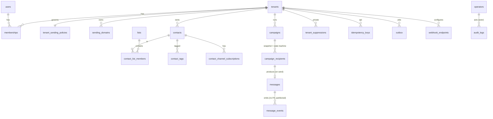

# 04 — Database Design

**Status:** v1.0 — **approved** (Phase 1 approval: D1–D4, 2026-10-14). Changes from now on go through change control: update the doc, the ADR if relevant, and PROGRESS.md.
**Engine:** PostgreSQL 18 (fallback 17)
**Last updated:** 2026-10-15 (S0.4: tenant predicate uses `NULLIF`; database-level grants added to §2. Sprint 1: ACL-ordering rule in §4, `list_user_memberships` user binding, `audit_logs` and `users` AUP columns in §5.1)

## 1. Conventions

- **Primary keys:** `uuid` **v7**, from `uuidv7()` on PG 18 or generated in the application on PG 17.
- **Tenant tables:** every one has `tenant_id uuid NOT NULL`, every index leads with `tenant_id`, and every one is marked 🔒 = `ENABLE` + `FORCE ROW LEVEL SECURITY` with:
  ```sql
  USING      (tenant_id = (SELECT NULLIF(current_setting('app.tenant_id', true), '')::uuid))
  WITH CHECK (tenant_id = (SELECT NULLIF(current_setting('app.tenant_id', true), '')::uuid))
  ```
  The `(SELECT …)` wrapper makes Postgres evaluate the setting once per query, not once per row.
  **`NULLIF` is required (found in S0.4):** after a transaction-local `set_config`, a pooled connection returns `''` (not NULL) for the setting in later transactions, and `''::uuid` raises an error instead of returning zero rows. With `NULLIF` an unset tenant matches nothing (fail closed). An integration test covers it.
- **Timestamps:** `timestamptz`. **Money:** `bigint` minor units plus `currency char(3)`.
- **Email:** stored as `email` plus `email_normalized`. Normalisation trims, lowercases and converts the domain to IDNA/punycode. It does **not** strip dots or `+tags`.
- **Phone:** `phone_e164`, with `+91` as the default region for parsing.
- **Constraints:** unique constraints on **partitioned** tables must include the partition key. Uniqueness that has to hold across partitions is therefore always enforced in non-partitioned tables (see C2 in the review).
- **Migrations:** run as `app_migrator`. RLS policies, roles, grants and functions are written in **raw SQL migrations**, reviewed like code.

## 2. Roles and grants

```sql
CREATE ROLE app_migrator LOGIN;                     -- owns schema; CI/CD only
CREATE ROLE app_user     LOGIN;                     -- runtime; NO BYPASSRLS; not owner
CREATE ROLE admin_user   LOGIN;                     -- admin app; NO BYPASSRLS
CREATE ROLE rls_lookup   NOLOGIN BYPASSRLS;         -- owns pre-tenant lookup functions
CREATE ROLE app_admin_fn NOLOGIN BYPASSRLS;         -- owns operator functions

REVOKE ALL ON SCHEMA public FROM PUBLIC;
REVOKE ALL ON DATABASE <db> FROM PUBLIC;
GRANT CONNECT ON DATABASE <db> TO app_migrator, app_user, admin_user;
GRANT CREATE  ON DATABASE <db> TO app_migrator;  -- the Drizzle migrator always runs CREATE SCHEMA IF NOT EXISTS
CREATE SCHEMA app AUTHORIZATION app_migrator;
GRANT USAGE ON SCHEMA app TO app_user, admin_user;
GRANT USAGE, CREATE ON SCHEMA app TO rls_lookup, app_admin_fn;  -- function owners
GRANT rls_lookup, app_admin_fn TO app_migrator WITH INHERIT FALSE, SET TRUE;  -- lets migrations assign function owners
-- Table grants are explicit per table (no blanket GRANT ALL).
-- audit_logs: INSERT, SELECT only. platform_suppressions: no grants to app_user/admin_user.
```

Implemented in `packages/db/sql/bootstrap.sql` (S0.4), run by `pnpm db:bootstrap` as a superuser. It is idempotent and re-asserts every role attribute.

## 3. Entity relationship overview



## 4. Pre-tenant lookup functions

All of these functions:
- are `SECURITY DEFINER`;
- set `search_path = pg_catalog, pg_temp` and use schema-qualified references;
- have `REVOKE ALL FROM PUBLIC`;
- return only the columns listed.

A CI catalog test enforces those three rules for every `SECURITY DEFINER` function.

**Migration order rule (found in Sprint 1):** `REVOKE ... FROM PUBLIC` and `GRANT EXECUTE` must run **before** `ALTER FUNCTION ... OWNER TO rls_lookup`. Only the owner can change the ACL, and a REVOKE by a non-owner is silently ignored (a warning, not an error), so the reverse order leaves PUBLIC able to execute the function. The catalog test caught exactly this.

| Function | Owner | Executable by | Returns | Purpose |
|---|---|---|---|---|
| `app.auth_api_key(p_prefix text, p_secret_hash bytea)` | rls_lookup | app_user | `tenant_id, key_id, scopes` — one row only if the hash matches (constant-time compare) **and** the key is not revoked or expired and the tenant is not closed | API-key authentication |
| `app.lookup_invitation(p_token_hash bytea)` | rls_lookup | app_user | `invitation_id, tenant_id, tenant_name, email, role, expires_at` — only for pending, unexpired invitations | Accept an invitation |
| `app.list_user_memberships(p_user_id uuid)` | rls_lookup | app_user | `tenant_id, tenant_name, role, tenant_status`, ordered by name. **Answers only when `p_user_id` equals the transaction's `app.user_id`** (set by `withUser`), so an API bug passing another user's ID returns nothing. **Implemented in S1.7.** | Organisation switcher after login |
| `app.resolve_provider_message(p_provider text, p_provider_message_id text)` | rls_lookup | app_user | `tenant_id, message_id, message_created_at, campaign_id, contact_id` | Routing SES events |
| `app.platform_suppressed(p_channel text, p_contact_ids uuid[])` | rls_lookup | app_user | `contact_id, suppressed boolean`. It **only answers for contacts belonging to the current tenant** (`app.tenant_id`); other IDs are silently dropped. It computes the HMAC internally and returns **no reason, date or source**. | Send-time and UI checks (no probing of arbitrary addresses) |
| `app.record_platform_suppression(p_channel, p_address_hmac, p_domain, p_reason, p_rule_id, p_classifier_version, p_evidence_ref)` | rls_lookup | app_user | void. `p_reason` must be `hard_bounce_permanent` or `invalid_domain` / `invalid_syntax` (CHECK). The application classifier (`06` §7.2) decides whether evidence qualifies; the function rejects missing `rule_id` or `classifier_version`. | Ingestion and import validation |
| `app.claim_due_campaigns(p_limit int)` | rls_lookup | app_user | `tenant_id, campaign_id`. Atomically moves due `scheduled` campaigns to `preparing` and writes their outbox rows | DB-backed scheduler (cross-tenant by nature) |
| `app.claim_outbox(p_limit int)` | rls_lookup | app_user | `id, tenant_id, topic, payload` for unpublished rows (`FOR UPDATE SKIP LOCKED`) | Outbox relay |
| `app.find_stalled_campaigns(p_idle interval)` / `app.expire_sending_leases()` | rls_lookup | app_user | `tenant_id, campaign_id` / count of rows moved `sending → unknown` | Reconciler and lease sweeper |
| `app.request_platform_recheck(p_contact_id uuid, p_reason text)` | rls_lookup | app_user | `review_id`. Accepts only contacts of the current tenant that are platform-suppressed. Rate-limited. | False-positive correction (`06` §7.4) |
| `app.admin_*` (for example `admin_tenant_health`, `admin_set_tenant_status`, `admin_remove_platform_suppression`, `admin_bulk_reverse_suppressions(classifier_version, rule_id, dry_run)`, `admin_set_deliverability_settings`) | app_admin_fn | admin_user | Defined per function; each one writes `audit_logs` | Operator console |

**Required tests for each function:**
1. `PUBLIC` cannot execute it, and `app_user` cannot execute any `admin_*` function.
2. It returns only the documented columns.
3. A wrong or expired input returns zero rows rather than an error that reveals existence.
4. `search_path` is pinned (catalog test).
5. It cannot be used to read another tenant's data beyond the documented output. For example, `auth_api_key` called with a valid prefix but the wrong hash returns nothing.

## 5. Tables

### 5.1 Identity, tenancy, operators

**`users`** (global; `app_user` may `SELECT`, `INSERT` (sign-up) and `UPDATE` only through the identity module; never `DELETE`): `id`, `email`, `email_normalized` UNIQUE, `password_hash`, `name`, `email_verified_at`, `mfa_enabled`, `terms_accepted_at`, `terms_version`, `aup_accepted_at`, `aup_version` (added in S1.1), `last_login_at`, `created_at`, `updated_at`.

**`user_tokens`**: `id`, `user_id`, `purpose` (`verify_email`, `reset_password`, `change_email`), `token_hash bytea` UNIQUE, `expires_at`, `used_at`, `created_at`.

**`mfa_factors`**: `id`, `user_id`, `type` (`totp`), `secret_ciphertext bytea`, `key_id`, `recovery_codes_hashed bytea[]`, `last_used_step bigint` (replay protection), `created_at`.

**`tenants`** 🔒 (policy `id = current tenant`; lookups go through functions):
| column | notes |
|---|---|
| id, name, slug UNIQUE | |
| status | `pending_review, active, paused, suspended, closed` |
| data_region | default `ap-south-1` |
| currency, timezone, locale | defaults `INR`, `Asia/Kolkata`, `en-IN` |
| postal_address jsonb | required before any campaign send |
| gstin text null | India GST registration (optional, validated format) |
| ses_tenant_name text | `t-{id}`; null until approved |
| created_at, updated_at | |

**`tenant_sending_policies`** 🔒 (one row per tenant; quotas are **configurable**; defaults in `06-deliverability-policy.md`):
`tenant_id` PK, `tier` (`sandbox, new, standard, trusted`), `send_mode` (`sandbox, live`), `daily_limit`, `hourly_limit`, `max_rate_per_sec`, `max_contacts`, `warmup_day`, `pause_reason`, `paused_at`, `reviewed_by_operator_id`, `reviewed_at`, `updated_at`. Tenants can read their own row. Only operator functions can update it.

**`memberships`** 🔒: `id`, `tenant_id`, `user_id`, `role` (`owner, admin, marketer, developer, viewer`), `created_at`; UNIQUE `(tenant_id, user_id)`. A deferred constraint trigger requires every tenant to keep at least one owner.

**`invitations`** 🔒: `id`, `tenant_id`, `email_normalized`, `role`, `token_hash bytea` UNIQUE, `invited_by`, `expires_at`, `accepted_at`, `revoked_at`.

**`api_keys`** 🔒: `id`, `tenant_id`, `name`, `prefix` UNIQUE, `secret_hash bytea`, `scopes text[]`, `environment` (`live, test`), `created_by`, `last_used_at`, `revoked_at`, `expires_at`.

**`audit_logs`** 🔒 (`app_user` and `admin_user` get INSERT and SELECT only; **range-partitioned monthly**; implemented in S1.9 with partitions through 2027-12 plus a default partition, and two policies: tenants **read** only their rows; the runtime role may **append** rows for its tenant or with no tenant, e.g. login events, which no tenant can ever read): `id`, `tenant_id` null (null for platform-level operator actions; those rows are not visible to tenants), `actor_type` (`user, api_key, system, operator`), `actor_id`, `action`, `target_type`, `target_id`, `metadata jsonb`, `ip inet`, `user_agent`, `created_at`. Retention: at least 1 year, plus 180 days of ICT logs kept in India (CERT-In).

**`operators`** (global; only `admin_user` has grants): `id`, `email`, `password_hash`, `mfa_secret_ciphertext`, `role` (`support, reviewer, admin`), `disabled_at`, `last_login_at`.

### 5.2 Sending domains

**`sending_domains`** 🔒: `id`, `tenant_id`, `domain` (punycode), `status` (`pending, verified, degraded, failed, disabled`), `dkim_tokens jsonb`, `dkim_status`, `mail_from_domain` (for example `bounce.example.in`), `mail_from_status`, `dmarc_status`, `dmarc_policy`, `ses_identity_arn`, `last_checked_at`, `verified_at`.
- UNIQUE `(tenant_id, domain)`.
- **Global partial unique index** `(domain) WHERE status IN ('verified','degraded')`, so one domain can't be verified by two tenants.
- Free-mail domains are rejected through the `blocked_from_domains` reference table.

### 5.3 Audience

**`contacts`** 🔒:
| column | notes |
|---|---|
| id, tenant_id | |
| email, email_normalized | nullable; `CHECK (email_normalized IS NOT NULL OR phone_e164 IS NOT NULL)` |
| phone_e164 | Release 2 channels |
| first_name, last_name, attributes jsonb (GIN) | |
| display_status | **derived cache** for the UI only (`subscribed, unsubscribed, bounced, complained, undeliverable`). It is **never** used for send decisions (FR-3). |
| source, consent jsonb | `{basis, captured_at, ip, notice_version, attested_by}` |
| last_engaged_at | used for sunsetting |
| created_at, updated_at, deleted_at | soft delete, then **purged after 30 days** (erasure) |

- UNIQUE `(tenant_id, email_normalized) WHERE deleted_at IS NULL AND email_normalized IS NOT NULL`
- UNIQUE `(tenant_id, phone_e164) WHERE deleted_at IS NULL AND phone_e164 IS NOT NULL`

**`contact_fields`** 🔒, **`lists`** 🔒 (`double_opt_in bool`), **`contact_list_members`** 🔒 (PK `tenant_id, list_id, contact_id`), **`tags`** 🔒, **`contact_tags`** 🔒: as in v0.1.

**`contact_channel_subscriptions`** 🔒: PK `(tenant_id, contact_id, channel)`, `status` (`subscribed, unsubscribed, pending_confirmation`), `changed_at`, `source` (`import, api, form, unsubscribe_link, one_click, admin, double_opt_in`), `evidence jsonb` (token key ID, IP, user agent).

**`segments`** 🔒: `definition jsonb` (validated rule tree compiled to parameterised SQL), `cached_count`, `counted_at`.

**`imports`** 🔒 / **`exports`** 🔒: `file_key`, `status`, `column_mapping`, `options`, `totals`, `error_report_key`, `consent_attestation jsonb` (required for imports), `created_by`, `started_at`, `finished_at`.

### 5.4 Content and campaigns

**`templates`** 🔒: `id`, `tenant_id`, `name`, `channel`, `subject`, `preheader`, `mjml_source`, `html_compiled`, `text_template`, `editor_json`, `created_by`, `updated_at`, `deleted_at`.

**`campaigns`** 🔒: `id`, `tenant_id`, `name`, `channel`, `stream` (`marketing`), `status` (`draft, scheduled, preparing, sending, paused, completed, cancelled, failed`), `template_id`, `content_snapshot jsonb` (frozen at schedule time), `subject`, `from_name`, `from_email`, `reply_to`, `sending_domain_id`, `audience jsonb`, `scheduled_at`, `started_at`, `completed_at`, `last_progress_at`, `stats jsonb` (asynchronous cache), `created_by`, timestamps, `deleted_at`.
- Index: `(status, scheduled_at) WHERE status = 'scheduled'`. The scheduler uses it through `app.claim_due_campaigns` (§4).

**`campaign_recipients`** 🔒 (**not partitioned**; this is the idempotency anchor):
| column | notes |
|---|---|
| tenant_id, campaign_id, contact_id | **PK** |
| email_normalized | snapshot |
| status | `pending, sending, sent, failed, skipped, unknown, unknown_final` |
| attempt_count smallint | retryable attempts (provider never accepted) |
| lease_owner text, lease_expires_at | set when moving to `sending` |
| batch_no int | |
| provider_message_id text | set on `sent`, or when reconciled from `unknown` |
| skip_reason / last_error | |
| updated_at | |

- Index: `(tenant_id, campaign_id, status)`, and partial `(lease_expires_at) WHERE status = 'sending'`.
- **Transitions are guarded in SQL**, for example `UPDATE … SET status='sending' WHERE status='pending' AND …`. Any other transition is rejected by a trigger that checks a state-transition table. Tests cover every allowed and disallowed transition.
- Rows are archived or pruned 90 days after the campaign completes (aggregates stay in `campaigns.stats`).

**`links`** 🔒: `id`, `tenant_id`, `campaign_id`, `url`, `url_hash`; UNIQUE `(tenant_id, campaign_id, url_hash)`.

### 5.5 Messages, events, idempotency

**`messages`** 🔒 (**partitioned monthly** on `created_at`; PK `(id, created_at)`; **no cross-partition uniqueness is relied on**):
`id`, `created_at`, `tenant_id`, `campaign_id` null, `contact_id` null, `stream` (`marketing, transactional, system`), `channel`, `to_address`, `provider`, `provider_message_id`, `status` (`sent, delivered, bounced, complained, failed`), `error jsonb`, `sent_at`.
- Index `(provider, provider_message_id)` per partition, used by `resolve_provider_message`, which searches recent partitions first.

**`message_events`** 🔒 (**partitioned monthly** on `occurred_at`; **no FK**; it stores `message_id` and `message_created_at`):
`id`, `tenant_id`, `message_id`, `message_created_at`, `campaign_id`, `contact_id`, `type` (`send, delivered, open, click, bounce_hard, bounce_soft, complaint, unsubscribe, rejected, delivery_delay`), `link_id`, `is_machine bool`, `metadata jsonb`, `ip inet`, `user_agent`, `occurred_at`, `received_at`.
- Retention: raw IP and user agent are kept 90 days, then nulled. Partitions are kept 13 months, then exported to S3 and dropped.

**`processed_provider_events`** (non-partitioned; written only by the ingestion worker through `app_user` with INSERT and SELECT): PK `(source, event_id)` (SNS `MessageId`), `processed_at`. Rows are pruned after 14 days.

**`idempotency_keys`** 🔒 (non-partitioned): PK `(tenant_id, key)`, `request_hash bytea`, `status` (`in_progress, completed`), `response_code`, `response_body jsonb`, `created_at`, `expires_at` (24 h). Behaviour:
- same key + same hash → replay the stored response;
- same key + different hash → **422**;
- `in_progress` → **409**.

**`outbox`** 🔒: `id`, `tenant_id`, `topic`, `payload jsonb`, `created_at`, `published_at` null. Index `(created_at) WHERE published_at IS NULL`. The relay reads through `app.claim_outbox(limit)` (rls_lookup), because it serves all tenants. Published rows are pruned after 7 days.

### 5.6 Suppression

**`tenant_suppressions`** 🔒 (private to the tenant): `id`, `tenant_id`, `channel`, `address_normalized`, `reason` (`unsubscribe, complaint, soft_bounce_repeated, manual, provider_tenant_list`), `source_message_id`, `created_by`, `created_at`.
- UNIQUE `(tenant_id, channel, address_normalized)`.
- Rows with reason `complaint` can't be deleted by tenants (trigger plus service rule).

**`platform_suppressions`** (**no grants** to `app_user` or `admin_user`; accessed only through functions; **no plaintext addresses**; rules in `06` §7.2–7.4):
`id`, `channel`, `scope` (`address, domain`), `address_hmac bytea` (HMAC-SHA256 with a KMS-held pepper; null for domain scope), `domain` (domain scope only), `reason` (`hard_bounce_permanent, invalid_domain, invalid_syntax, spam_trap, abuse`), `rule_id`, `classifier_version`, `evidence_ref` (an opaque reference to the originating `message_events` row or validation record), `source` (`ses_event, import_validation, operator`), `first_seen_at`, `last_seen_at`, `next_revalidation_at` (domain scope: 30 days), `removed_at`, `removed_by_operator_id`, `removal_reason`.
- UNIQUE `(channel, address_hmac) WHERE removed_at IS NULL AND scope = 'address'`
- UNIQUE `(channel, domain) WHERE removed_at IS NULL AND scope = 'domain'`

**`platform_suppression_reviews`** (only operator functions have access): `id`, `suppression_id`, `requested_by_tenant_id`, `request_reason`, `status` (`open, removed, upheld`), `decided_by`, `decided_at`. Tenants create these only through `app.request_platform_recheck(contact_id, reason)`, which accepts only the tenant's own contacts.

**`deliverability_settings`** (global, versioned; only operators can write; ADR-015): `version`, `settings jsonb` (thresholds, minimum volumes, absolute backstops, tier defaults), `effective_from`, `changed_by`, `change_reason`.

### 5.7 Webhooks, billing, privacy

**`webhook_endpoints`** 🔒: `id`, `tenant_id`, `url`, `secret_ciphertext`, `key_id`, `event_types text[]`, `status` (`active, disabled_auto, disabled_manual`), `consecutive_failures`, `first_failure_at`, `created_at`.
**`webhook_deliveries`** 🔒: `id` (the `webhook-id`), `tenant_id`, `endpoint_id`, `event_type`, `payload jsonb`, `attempt`, `status`, `response_code`, `error_class` (`ssrf_blocked, dns, timeout, tls, http_status, redirect`), `next_attempt_at`, `created_at`. Pruned after 30 days.

**`plans`** (global): `code`, `name`, `limits jsonb`, `price_minor`, `currency`, `interval`, `provider`, `provider_plan_id`.
**`subscriptions`** 🔒: `tenant_id` UNIQUE, `plan_id`, `provider`, `provider_subscription_id`, `status`, `current_period_start`, `current_period_end`.
**`usage_counters`** 🔒: PK `(tenant_id, period, metric)`.
**`invoices`** 🔒 (GST data): `number`, `tenant_id`, `gstin`, `place_of_supply`, `taxable_minor`, `cgst/sgst/igst_minor`, `provider_invoice_id`, `issued_at`.

**`data_requests`** 🔒: `id`, `tenant_id`, `contact_id`, `type` (`export, erase`), `status`, `requested_by`, `requested_at`, `completed_at`.

## 6. Scale notes

- Monthly partitions on `messages`, `message_events` and `audit_logs`. A job (pg_partman or our own) creates partitions 3 months ahead.
- Campaign stats are counted in valkey-queue and flushed to `campaigns.stats` every 5 s. If the counters are lost, they are **recomputed from `message_events`**, which remain the source of truth.
- Connection pooling: none in the MVP (an RDS connection budget per service). If one is added, it must be PgBouncer ≥ 1.21 in transaction mode with `max_prepared_statements`, or RDS Proxy after a pinning test. Session-level `SET` is never used.
- ClickHouse arrives in Release 2 if `message_events` exceeds about 50M rows/month.
